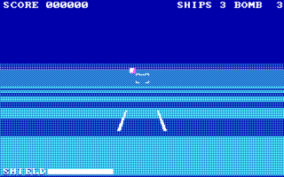
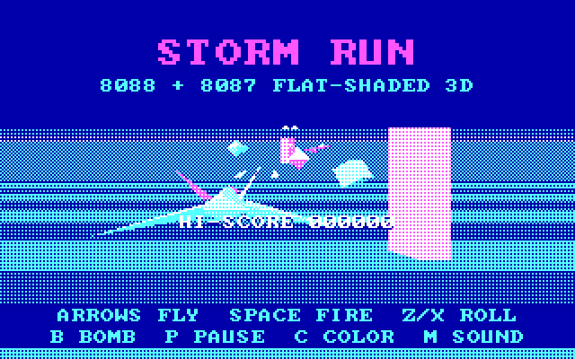
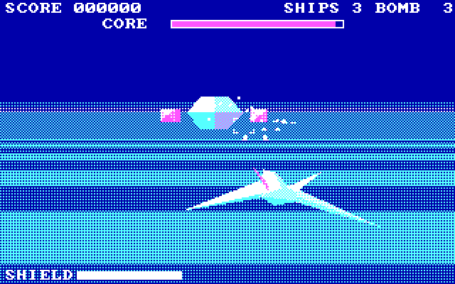

# STORM RUN (FLIGHT87)

A flat-shaded 3D rail shooter for the original IBM PC: **8088 + 8087 + CGA + PC speaker**.

You fly a delta-wing fighter low over a striped plain and through obstacle fields,
pillar forests and a corridor of gates. Along the way you shoot down waves of
enemy fighters, hovering gunships and ground turrets. The stage ends with a boss:
a large armoured core flanked by two cannons.



| | |
|---|---|
|  |  |

It is a single ~19 KB `.COM` file written in NASM assembly. It uses only 8086
instructions (`cpu 8086` is enforced) and 8087 instructions, and requires an 8087.

## Playing

```
FLIGHT87.COM
```

| Key | Action |
|---|---|
| Arrows / WASD | fly |
| Space / Ctrl | fire. Lasers inherit your sideways motion, so you aim by steering. The reticle shows where they will be. |
| Z / X | dodge roll left / right. Enemy bullets bounce off while you roll. |
| B | bomb: destroys every fighter and bullet on screen and damages the boss |
| P | pause |
| C | switch CGA palette |
| M | sound on/off |
| F | frame-rate counter |
| Esc | back to the title screen / quit |

Game rules:
- You have a shield bar and 3 ships.
- Obstacles, enemy craft and bullets drain the shield. Crystals restore it.
- Pillars, pyramids, columns and gates are solid; cubes, octahedra and other
  floating shapes can be shot.
- The boss's core is armoured until both of its cannons are destroyed.
- Clearing a stage awards a shield bonus and an extra bomb, then the next loop
  starts, harder and in a different palette.
- With no input, the title screen plays an attract-mode demo.

In DOSBox use `machine=cga`. DOSBox does not model 8087 timing (FPU
instructions are nearly free there), so real hardware is much slower than
DOSBox suggests. See *Performance*.

## Building

```
./build.sh
```

Needs `python3` and `nasm`. `tools/gen_data.py` generates `src/data.inc`, which
holds the sine table, the dither ramps and all the 3D models, including their
face normals.

Debug builds:

| Flag | Effect |
|---|---|
| `-DCOUNT` | 8087 instructions per frame on the HUD (with F) |
| `-DGOD` | invulnerable |
| `-DSTARTDIST=24100` | start part-way into the stage (24100 = just before the boss) |
| `-DFRAGILE` | one ship, almost no shield |

Example: `./build.sh -DGOD -DSTARTDIST=24100`

## How it works

### The 8087 does the 3D math
The 8087 is not much faster than the 8088 at a single multiply or divide (both
take ~100–200 clocks). The game benefits from it in three ways.

1. **All geometry is floating point on the 8087.** That covers:
   - rotation matrices built from a float sine table
   - vertex transforms
   - back-face culling (the camera is moved into object space, so each face
     costs one dot product)
   - Lambert shading
   - perspective divide
   - Sutherland–Hodgman clipping in 3D
   - ship physics and the chase camera
   - enemy aiming: every bullet's direction is normalised with `FSQRT`
2. **The two chips run in parallel.** The 8088 has to `WAIT` before each 8087
   instruction. Every FPU mnemonic is a macro that emits `WAIT` + opcode (as MASM
   used to do), so integer code placed between FPU instructions runs while the
   8087 is still busy. Three places use this on purpose:
   - **Ground:** while the 8087 computes the next stripe boundary (an FDIV), the
     8088 fills the current stripe's rows.
   - **Vertices:** while the 8087 does vertex *i*'s perspective FDIV, the 8088
     computes vertex *i−1*'s screen outcode.
   - **Faces:** while the 8087 does a face's lighting, the 8088 marks the
     vertices that face uses. Vertices used only by back faces are never
     transformed.
3. **The 8088 handles the integer work:** edge walking, dithered spans,
   sorting, collisions, game logic and the blit to CGA memory.

### Engine
- 2×2 ordered dithering turns CGA's 4 colours into 7-level shading ramps.
- Painter's algorithm. Objects are depth sorted; convex objects need no
  per-face sort; the ship, the gates and other non-convex models sort their faces.
- The ground is drawn as world-space stripes with distance fog. Only the ~12
  rows where a stripe boundary lands are computed.
- A 48-entity pool holds obstacles, enemies, bullets, lasers, pickups and boss
  parts. Each has a velocity, an AI routine, hit points and timers. Debris
  particles are a separate pool.
- The stage is an event script keyed on distance flown. Events set obstacle
  fields, spawn enemy waves and pickups, show messages and start the boss.
- The timer runs at 145.6 Hz. Its interrupt chains to the BIOS every 8th tick
  and plays PC speaker effects from tables: one PIT divisor or a noise entry
  per tick.
- Keyboard presses are latched in the keyboard interrupt, so a quick tap is
  never lost, even at a low frame rate.

## Performance

Build with `-DCOUNT` and press F to see the number of 8087 instructions per frame.

| Scene | 8087 instructions per frame |
|---|---|
| Quiet sections | ~4,000–6,000 |
| Busy fights | ~8,000–12,000 |

At roughly 100–120 clocks each on a 4.77 MHz 8087, plus filling and blitting,
that works out to an **estimated 3–5 fps on a stock IBM PC/XT**. A turbo XT
with an 8087-2 should do noticeably better. These numbers are estimates and
have not been measured on real hardware. Measurements from 86Box/PCem with an
8087, or from a real machine, are welcome.

## Layout

```
src/flight.asm    main: constants, main loop, rendering order, data, variables
src/fpu.inc       8087 WAIT-wrapper macros and helpers
src/system.inc    FPU detection, timer/keyboard interrupts, sound, random, timing
src/engine.inc    3D engine: ground, transform, culling, clipping, rasterizer, blit
src/sprites.inc   lasers, bullets, particles, rectangles, reticle
src/game.inc      game states, player, enemies and AI, script, collisions
src/hud.inc       text (normal and double size), HUD, title screen
src/stage.inc     stage script, obstacle sets, sound effects, strings
src/data.inc      generated tables and models (do not edit)
tools/gen_data.py generator for data.inc
build.sh          build script
FLIGHT87.COM      prebuilt binary
```
